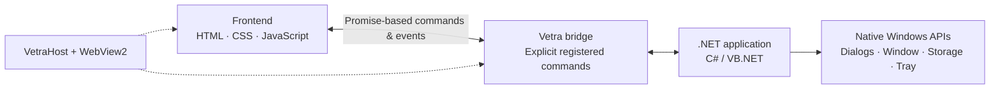

<div align="center">

# Vetra

### Modern web interfaces. Native Windows capabilities. One .NET application.

**A lightweight, framework-agnostic WebView2 foundation for C# and VB.NET WinForms applications.**

[](https://dotnet.microsoft.com/download)
[](https://www.microsoft.com/windows)
[](https://learn.microsoft.com/dotnet/csharp/)
[](https://learn.microsoft.com/dotnet/visual-basic/)
[](LICENSE)

[Why Vetra?](#why-vetra) · [Get started](#quick-start) · [Capabilities](#native-capabilities) · [Architecture](#how-it-works) · [Security](#security-by-design)

</div>

---

## Build desktop apps your way

If you've ever built a WinForms app with a WebView2 frontend, you know how much setup comes before you can build the actual application: initializing WebView2, serving local assets, connecting JavaScript to .NET, and wiring up native functionality.

**Vetra handles that foundation for you.** Build the interface with HTML, CSS, and JavaScript—including your preferred frontend tooling—while keeping application logic and Windows integration in .NET.

Use vanilla JavaScript, or bring your own React, Vue, Tailwind CSS, or Vite workflow. Vetra does not impose a UI library or frontend build system.

> **What Vetra is:** a hosting, communication, and native integration layer for WinForms + WebView2. It is not a full UI framework or a drop-in Electron replacement.

## Why Vetra?

| Without Vetra | With Vetra |
| --- | --- |
| Set up WebView2 and a local `www` folder for each app | Initialize a reusable `VetraHost` |
| Write request IDs and JSON messaging plumbing yourself | Invoke registered .NET commands with `await vetra.invoke(...)` |
| Rebuild file dialogs, preferences, and window controls | Enable ready-to-use native capabilities |
| Expose host APIs through custom message handlers | Explicitly allowlist callable commands |
| Maintain a homegrown host integration layer | Keep the web UI and native app concerns separate |

### At a glance

- **Frontend freedom** — Plain HTML/CSS/JS or your preferred frontend tools; no required styling framework.
- **JavaScript ↔ .NET bridge** — Promise-based calls, asynchronous handlers, structured errors, and .NET-to-JavaScript events.
- **Native Windows integration** — Window management, file/folder dialogs, local preferences, notifications, and system tray support.
- **Security-conscious defaults** — Trusted local origin, navigation restrictions, explicit bridge registration, and opt-in privileged capabilities.
- **Built for .NET developers** — A WinForms host, C# and VB.NET-friendly APIs, reusable templates, and a demo application.

## Quick start

**Requirements:** Windows 10/11, [.NET 10 SDK](https://dotnet.microsoft.com/download), and the [Microsoft Edge WebView2 Runtime](https://developer.microsoft.com/microsoft-edge/webview2/) (Evergreen).

Vetra v0.1.0 is currently documented with a **local NuGet feed**. The commands below run from a clone of the Vetra repository; they do not assume the packages or templates have been published to NuGet.org.

### 1. Clone and package

```powershell
git clone https://github.com/lazytitanz/Vetra.git
cd Vetra

New-Item -ItemType Directory -Force artifacts/nuget | Out-Null
dotnet pack src/Vetra.Core -c Release -o artifacts/nuget
dotnet pack src/Vetra.WinForms -c Release -o artifacts/nuget
dotnet pack templates/Vetra.Templates -c Release -o artifacts/nuget
```

`nuget.config` maps `VetraLocal` to `./artifacts/nuget`.

### 2. Install the project template

```powershell
dotnet new install .\artifacts\nuget\Vetra.Templates.0.1.0.nupkg
```

### 3. Create an app

```powershell
dotnet new vetra -n MyNewApp
cd MyNewApp
dotnet restore
dotnet run
```

The host automatically injects the `window.vetra` JavaScript client; your project doesn't need to ship a separate `vetra.js` file.

<details>
<summary><strong>Uninstall the template</strong></summary>

```powershell
dotnet new uninstall Vetra.Templates
```

</details>

## How it works



Vetra serves your local frontend through a WebView2 virtual host (`https://app.vetra.local`). Its bridge provides a controlled boundary between frontend code and .NET, instead of automatically exposing native objects or methods to JavaScript.

### Call .NET from JavaScript

Register commands in .NET:

```csharp
host.Bridge.Register("app.getGreeting", (string name) => $"Hello, {name}!");

host.Bridge.RegisterAsync("app.loadData", async ct =>
{
    return await dataService.LoadAsync(ct);
});
```

Invoke them in the frontend:

```javascript
const greeting = await vetra.invoke("app.getGreeting", "World");
console.log(greeting); // Hello, World!
```

Calls return Promises; failures reject with `{ code, message, details }`.

### Send events to the frontend

.NET:

```csharp
await host.Bridge.EmitAsync("app.dataUpdated", new { Count = 25 });
```

JavaScript:

```javascript
const unsubscribe = vetra.on("app.dataUpdated", (data) => {
  console.log(data.count);
});

// Call unsubscribe() when you no longer need the listener.
```

## Native capabilities

Privileged features are **disabled by default**. Opt in only to the capabilities your application needs:

```csharp
var options = new VetraOptions
{
    EnableDialogs = true,
    EnableWindowControls = true,
    EnableStorage = true,
    EnableNotifications = false,
    EnableSystemTray = false
};
```

The frontend can query which capabilities are available:

```javascript
const capabilities = await vetra.app.getCapabilities();
```

| Capability | Example | Purpose |
| --- | --- | --- |
| Window controls | `vetra.window.minimize()` | Minimize, maximize, restore, and inspect window state |
| Native dialogs | `vetra.dialogs.openFolder()` | Select folders and files using Windows dialogs |
| Preferences | `vetra.storage.set("theme", "dark")` | Store application preferences locally |
| App information | `vetra.app.getInfo()` | Read application information |
| Notifications | `vetra.notifications.show(...)` | Show informational Windows toasts |
| System tray | `vetra.tray.configure(...)` | Configure a tray icon and menu |

<details>
<summary><strong>More examples</strong></summary>

**Window controls**

```javascript
await vetra.window.minimize();
await vetra.window.maximize();
await vetra.window.restore();
const state = await vetra.window.getState();
```

**Native file dialogs**

```javascript
const folder = await vetra.dialogs.openFolder();
const file = await vetra.dialogs.openFile({
  filters: [{ name: "Images", extensions: ["png", "jpg"] }]
});
```

Cancelled dialogs return `null` or an empty array.

**Preferences**

```javascript
await vetra.storage.set("theme", "dark");
const theme = await vetra.storage.get("theme", "light");
```

Preferences are stored as JSON under LocalApplicationData. Do **not** store secrets in plaintext.

**Notifications**

```javascript
await vetra.notifications.show({
  title: "Task Complete",
  message: "Your operation finished."
});
```

Informational toasts use inbox WinRT APIs and a Vetra-owned AppUserModelID / Start Menu shortcut helper. Interactive click activation is **not** implemented in v0.1.

**System tray**

```javascript
await vetra.tray.configure({
  tooltip: "My App",
  visible: true,
  menuItems: [{ id: "about", text: "About" }]
});
```

</details>

## Add Vetra to an existing WinForms app

1. Target `net10.0-windows` (or `net10.0-windows10.0.17763.0`).
2. Add the `Vetra.WinForms` package from the configured local feed (version `0.1.0`).
3. Place your frontend in `www/` and configure it to copy to the output directory.
4. Add `VetraHost` to your form:

```csharp
using Vetra;
using Vetra.WinForms;

public sealed class MainForm : Form
{
    private readonly VetraHost _host = new() { Dock = DockStyle.Fill };

    public MainForm()
    {
        Controls.Add(_host);
        Shown += async (_, _) =>
        {
            await _host.InitializeAsync(new VetraOptions
            {
                WebRoot = "www",
                StartPage = "index.html",
                EnableDialogs = true,
                EnableWindowControls = true
            });

            _host.Bridge.Register("app.getVersion", () => Application.ProductVersion);
        };
    }
}
```

To add the package while working in a solution configured to use Vetra's local feed:

```powershell
dotnet add package Vetra.WinForms --version 0.1.0
```

`Vetra.WinForms` depends on `Vetra.Core` and `Microsoft.Web.WebView2`.

### VB.NET support

Vetra's public APIs also support VB.NET:

```vb
Dim host As New VetraHost With {.Dock = DockStyle.Fill}
Controls.Add(host)

Await host.InitializeAsync(New VetraOptions With {
    .WebRoot = "www",
    .StartPage = "index.html",
    .EnableDialogs = True
})

host.Bridge.Register("app.getVersion", Function() Application.ProductVersion)
```

A dedicated VB.NET project template is **not** included in v0.1.

## Security by design

Native access should be deliberate. Vetra provides several boundaries to help keep the WebView2 UI isolated from privileged host functionality:

- **Local trusted origin:** Frontend assets are mapped to `https://app.vetra.local` with `Deny` host resource access.
- **Restricted navigation:** Navigations and frames outside the trusted origin are cancelled.
- **Origin checks:** Bridge messages from untrusted origins are ignored.
- **Explicit registration:** Only commands registered with `Bridge.Register` / `RegisterAsync` can be invoked.
- **Opt-in native access:** Disabled capabilities return `capability_disabled` rather than executing privileged operations.

These safeguards are not a substitute for validating command input and protecting sensitive operations in your .NET application. Do not navigate the privileged host to arbitrary external websites. Host-injected scripts may also be affected by restrictive Content Security Policies.

## Profiles and publishing

### WebView2 profile storage

Vetra creates a persistent user-data folder per application and shares a `CoreWebView2Environment` among hosts in the same process by default:

```text
%LocalAppData%\{Company}\{App}\Vetra\WebView2
```

Override the path with `UserDataFolder`, or set `IsolateWebViewProfile = true` for a dedicated profile.

### Publish your app

```powershell
dotnet publish samples/Vetra.Demo -c Release -r win-x64 --self-contained false
dotnet publish samples/Vetra.Demo -c Release -r win-x64 --self-contained true
```

- Frontend assets in `www/` currently remain external content files next to the published application.
- Single-file publish does **not** create a completely self-contained one-executable WebView2 + frontend bundle.
- `win-x64` is a typical distribution target. ClickOnce is not required.

## Project structure

```text
Vetra/
├── src/Vetra.Core             # Host-agnostic bridge and protocol
├── src/Vetra.WinForms         # WebView2 host and native capabilities
├── samples/Vetra.Demo         # Interactive demonstration
├── templates/Vetra.Templates  # dotnet new project template
├── tests/Vetra.Tests          # Automated tests
└── artifacts/nuget            # Local package output
```

### Build and test

```powershell
dotnet build Vetra.slnx -c Release
dotnet test tests/Vetra.Tests -c Release
```

### Manual validation

- Run `samples/Vetra.Demo` and exercise the demo sections.
- Verify `window.vetra` exists without a bundled `vetra.js`.
- Open another host in the same process and confirm profile sharing.
- Create and run a sample project via `dotnet new vetra` using the local feed.

## Future possibilities

Some potential directions for future development (not features available in v0.1):

- **Custom window chrome helpers:** Frameless WinForms windows with Windows-friendly resize and snap behavior.
- **Frontend starter templates:** Optional Vite + Tailwind CSS quickstarts without imposing a frontend framework on the core library.
- **Embedded frontend assets:** Optional approaches to package frontend resources without an external `www/` folder, subject to WebView2 deployment requirements.

## License

Vetra is licensed under the [MIT License](LICENSE).
